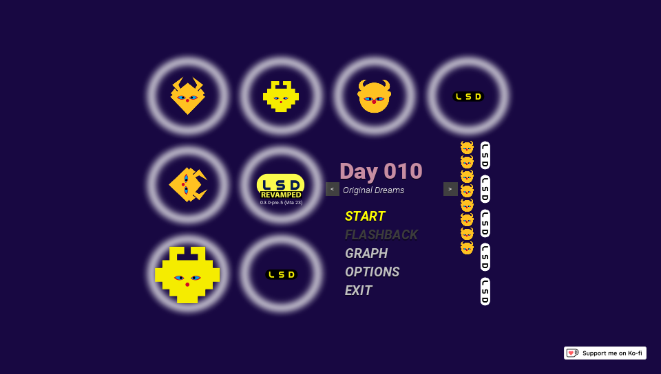
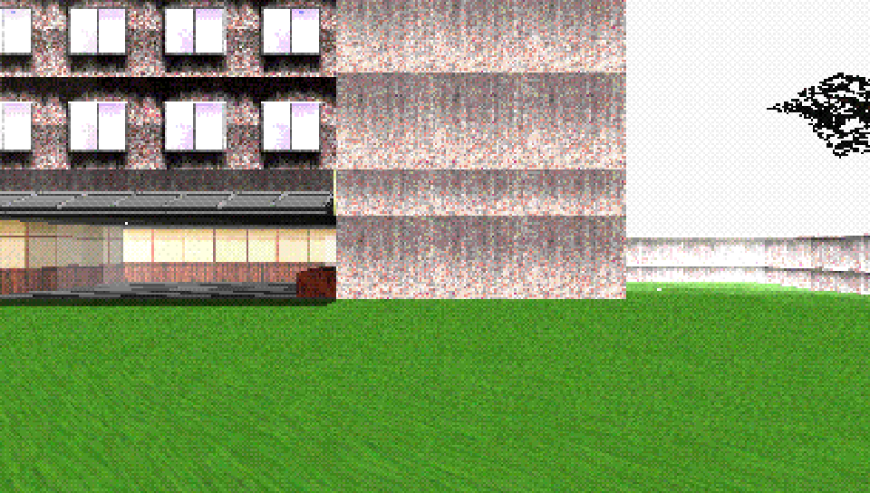
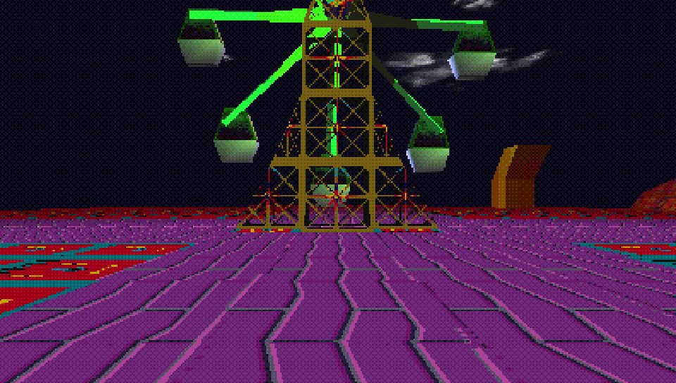
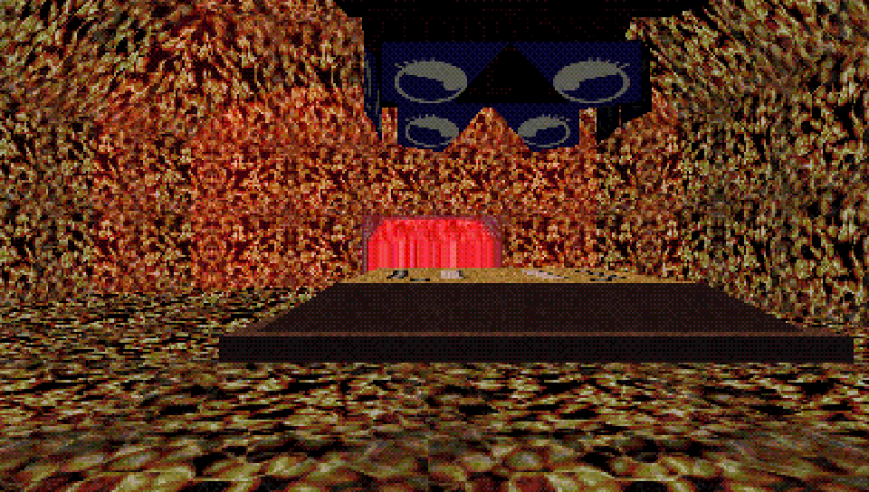

# LSD Revamped for the PS Vita

A native PS Vita port of [LSD Revamped](https://github.com/figglewatts/LSDRevamped), Figglewatts' remake of
*LSD: Dream Emulator* (1998). The game is reimplemented in C on VitaSDK and vitaGL, following LSD Revamped's
Unity code closely; the dreams, entity scripts, sounds and menus are converted from the LSD Revamped project by
the tools in this repository. It runs at a steady 60 fps.

The repository contains no game data. The data is built on a PC from LSD Revamped's own repository, see
[Game data](#game-data).

<p align="center">
  
  
  
  
</p>

## What works

- All 14 dreams of the original journal, linking, the dream graph, flashbacks, special days (text and video
  days), the Grey Man, day progression and saving
- Classic graphics (pixelation, dithering, affine texture mapping, PSX framerate limit) and Revamped graphics,
  with graphics profiles
- Classic (tank) and Revamped (first person) controls, custom control schemes and rebinding
- The original soundtrack, synthesised from the PS1 sequences like LSD Revamped does, and the Revamped soundtrack
- The intro, title screen, credits, pause menu and options. The options are drawn larger than on PC, L/R change
  tabs, and they can be used with the touch screen.

Not included: mod and custom journal loading (only "Original Dreams" is available), and the PC-only resolution,
quality and fullscreen options.

## Installation

Requirements:

- A PS Vita or PS TV running HENkaku/Ensō
- `libshacccg.suprx` extracted to `ur0:data/`
  ([guide](https://samilops2.gitbook.io/vita-troubleshooting-guide/shader-compiler/extract-libshacccg.suprx))
- About 350 MB free on `ux0:`

Steps:

1. Install `LSDRevamped-Vita.vpk` from the [releases](../../releases) page (or from VitaDB).
2. Build the game data as described below and copy the `lsdr` folder it makes to `ux0:data/`, so that you have
   `ux0:data/lsdr/dreams.pak`.
3. Start the game.

No plugins are needed.

## Game data

LSD Revamped's repository includes the original game's files. `tools/build_data.py` downloads it at the commit
this port was made against, converts what the Vita needs and packs it.

On Windows, download `LSDRevamped-Vita-DataBuilder-win64.zip` from the [releases](../../releases) page, unzip it
somewhere with a short path (for example `C:\LSDR`) and double-click `Build LSD data.bat`. It includes everything
it needs and leaves an `lsdr` folder next to itself when it's done.

On Linux (or in WSL):

```sh
sudo apt update && sudo apt install git python3-numpy python3-pil ffmpeg gcc fonts-noto-cjk
git clone https://github.com/arielxflores/LSDRevamped-Vita.git
cd LSDRevamped-Vita
python3 tools/build_data.py
```

It downloads about 450 MB, needs about 1.5 GB of free space and takes 10 to 30 minutes on a typical PC. The
result is in `lsdr-data/lsdr/` (around 330 MB): copy that folder to `ux0:data/` over USB or FTP with VitaShell.
More details and troubleshooting are in [docs/data.md](docs/data.md).

## Controls

Both default schemes use the same buttons; with Revamped controls the right stick looks around.

| Action | Button |
| --- | --- |
| Move | Left stick, D-Pad |
| Run | Cross |
| Interact | Circle |
| Look up / down | Triangle / Square |
| Strafe | L / R |
| Next graphics profile | Select |
| Pause | Start |
| Quit | Hold Start + Select for two seconds |

Controls can be changed in Options > Controls.

## Notes

- Saves, settings and control schemes are kept in `ux0:data/lsdr/` (`save.txt`, `settings.txt`, `schemes.txt`),
  along with a log (`log.txt`) and the compiled shader cache.
- The game runs the CPU at 444 MHz and the GPU at 222 MHz.
- The Ko-fi and modding docs buttons in the About tab open the Vita's web browser.

## Building

See [docs/building.md](docs/building.md). There is also a Linux build of the same code used for automated
testing, described in [docs/testing.md](docs/testing.md).

## Credits

- Figglewatts (Sam Gibson) for LSD Revamped, and for libLSD and EZSynth, which the file readers and the music
  synthesiser follow
- Osamu Sato, OutSide Directors Company and Asmik Ace for *LSD: Dream Emulator*
- The LSD Revamped contributors and the Revamped soundtrack artists, credited in the game's credits
- Rinnegatamante for vitaGL and vitaShaRK, bythos for SceShaccCgExt, and the VitaSDK team
- The LiveArea icon and startup gate use the LSD Revamped logo
- Dominic Szablewski (pl_mpeg), Sean Barrett (stb_vorbis, stb_image_write), Yann Collet (LZ4), the Lua team,
  Daniel Hepper (font8x8) and Lachlan Tychsen-Smith (math-neon)

## License

The port is released under the GNU GPL v3 (it links vitaGL, which is GPLv3), see [LICENSE](LICENSE). Code
derived from LSD Revamped, libLSD and EZSynth is MIT licensed, as are several bundled libraries; their notices
are in [THIRD_PARTY.md](THIRD_PARTY.md).

*LSD: Dream Emulator* and its content belong to their respective owners. None of it is included here.
